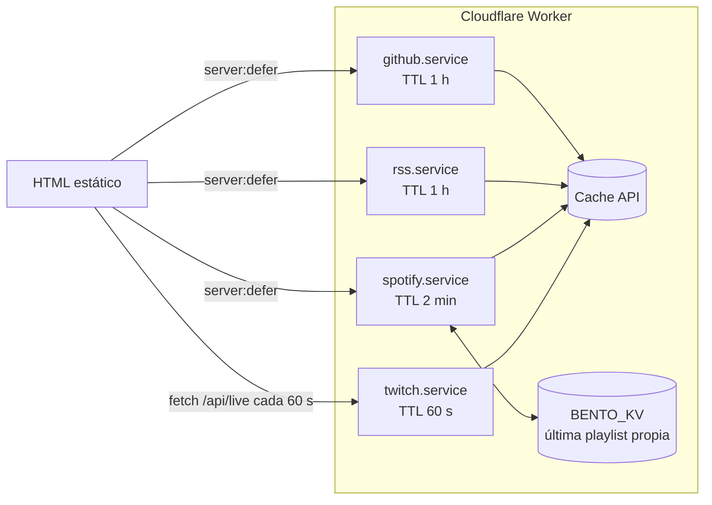
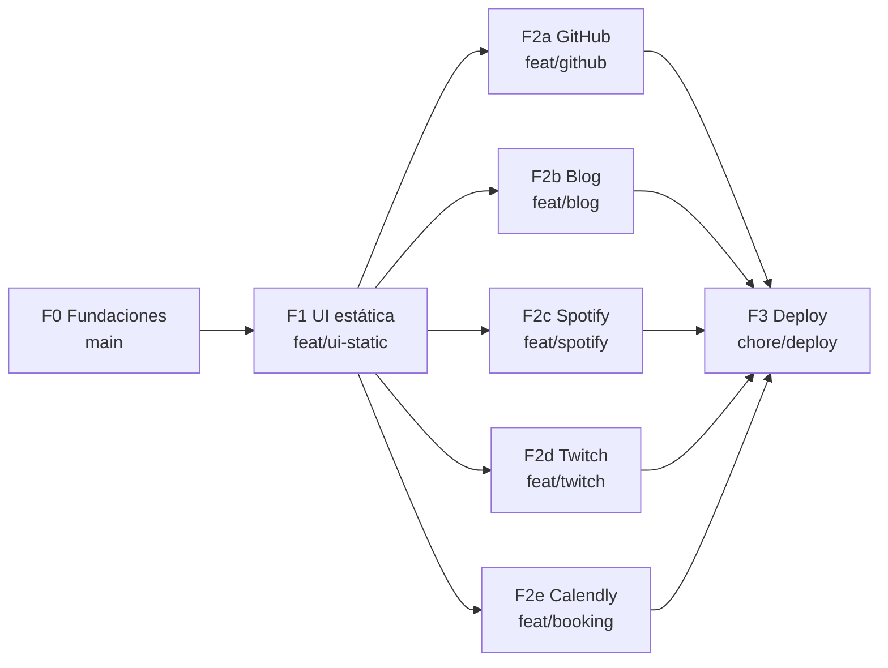

# bento-tree — Plan de desarrollo

Linktree personal con grid bento. Fuente de verdad visual: `design/` (exportado de Claude Design).

## 1. Decisiones de stack

| Tema               | Decisión                                                                                                | Motivo                                                                             |
| ------------------ | ------------------------------------------------------------------------------------------------------- | ---------------------------------------------------------------------------------- |
| Framework          | Astro 7 + TypeScript estricto                                                                           | Página casi estática; JS mínimo; server islands para tiles dinámicas               |
| Render             | Página prerenderizada + `server:defer` en tiles dinámicas + endpoints `src/pages/api/*`                 | HTML estático gratis e ilimitado en Cloudflare; solo lo dinámico ejecuta el Worker |
| Hosting            | Cloudflare Workers (`@astrojs/cloudflare` 14)                                                           | Plan free alcanza; KV + Cache API incluidos                                        |
| Estado persistente | 1 namespace KV (`BENTO_KV`) solo para Spotify                                                           | Límite free: 1.000 escrituras/día; se escribe solo si cambia                       |
| Caché              | Cache API de Cloudflare con TTL por integración                                                         | Gratis, sin cuota de escrituras                                                    |
| JS de cliente      | Scripts Astro (`<script>`) en TS, sin framework UI                                                      | Filtros, tema, copiar, compartir, polling Twitch, Calendly                         |
| Estilos            | CSS propio con custom properties (tokens del diseño) + estilos scoped de Astro                          | Pixel perfect exige valores exactos; sin Tailwind para no traducir ni redondear    |
| Fuentes            | Los mismos `.woff2` embebidos en el bundle del diseño, self-hosted                                      | Glifos idénticos al diseño                                                         |
| i18n               | Rutas `/` (es) y `/en/` prerenderizadas; selector ES/EN = links; autodetección en primera visita        | SEO por idioma; las server islands reciben `lang` sin hidratar diccionarios        |
| Tema               | Claro por defecto (igual al diseño); preferencia en `localStorage`; script inline en `<head>` sin flash | Igual al diseño + persistencia                                                     |
| Package manager    | pnpm                                                                                                    | Instalado                                                                          |
| Tests              | Vitest (lógica de servicios) + Playwright (regresión visual contra el diseño + interacciones)           | Pixel perfect verificable                                                          |

## 2. Arquitectura

Regla: **`components/` no tiene lógica de negocio ni acceso a datos**; todo lo que decide, consulta APIs o maneja estado vive en `features/<dominio>/`. Las features usan componentes de `ui/`; `ui/` nunca importa de `features/`.

```
src/
  config/
    site.ts              # perfil, links, orden/tamaño/categoría de tiles, ids externos (repo, twitch, rss, calendly, playlist default)
  i18n/
    es.ts  en.ts         # diccionarios (textos del diseño)
    index.ts             # getStrings(lang), tipos Lang
  styles/
    tokens.css           # colores, radios, bordes, sombras, tipografía, breakpoints
    global.css           # reset, base, foco, utilidades .press/.tile, reduced-motion
  assets/fonts/          # Space Grotesk, Space Mono (.woff2 del bundle)
  layouts/
    BaseLayout.astro     # <head>, fuentes, meta/OG, script inline de tema
  components/
    ui/                  # presentacionales puros, props → markup
      Icon.astro         # set de SVG del diseño (code, tv, briefcase, book, pen, grid, at, copy, share, calendar, headphones, contrast, arrow)
      IconBox.astro      # caja 48×48 con borde
      Tile.astro         # shell de tarjeta: color, span (s2/s4/r2/m1), categoría, href opcional, slot
      Tag.astro          # etiqueta rectangular (Go, CLI, React…)
      Pill.astro         # badge redondeado (freelance, "4 guías", EN VIVO)
      Button.astro       # botón/anchor con estilo .press (variantes: primary, surface, dark)
      SegmentedControl.astro  # grupo de botones con borde común (filtros, idioma)
    layout/
      Header.astro       # marca ~/links + slots para filtros y herramientas
      Marquee.astro
      BentoGrid.astro    # grid 4/2/2 columnas
      Footer.astro
  features/
    profile/      ProfileTile.astro, copy-email.client.ts
    filters/      FilterBar.astro, filters.client.ts
    theme/        ThemeToggle.astro, theme.client.ts, theme-init.inline.ts
    locale/       LanguageSwitch.astro, locale-redirect.client.ts
    share/        ShareButton.astro, share.client.ts
    links/        LinkTile.astro (LinkedIn, X, Portfolio), GuidesTile.astro
    github/       FeaturedRepoTile.astro, FeaturedRepoContent.astro (island), github.service.ts
    blog/         BlogTile.astro, LatestPostContent.astro (island), rss.service.ts, rss.parse.ts
    spotify/      PlaylistLink.astro, PlaylistContent.astro (island), spotify.service.ts, spotify.auth.ts
    twitch/       TwitchTile.astro, twitch.service.ts, live-poller.client.ts
    booking/      BookCallTile.astro, calendly.client.ts
  lib/server/
    cache.ts            # cached(key, ttl, loader) sobre Cache API
    kv.ts               # acceso tipado a BENTO_KV
    http.ts             # fetchJson con timeout y errores tipados
    env.ts              # lectura/validación de bindings y secrets
  pages/
    index.astro         # es
    en/index.astro      # en
    api/live.ts         # estado Twitch (Cache-Control 60 s)
scripts/
  spotify-auth.ts       # flujo OAuth único para obtener el refresh token
tests/
  unit/                 # vitest: servicios y parsers
  visual/               # playwright: diff contra design/reference.html
design/                 # export de Claude Design (no se edita)
```

### Contrato de las tiles dinámicas

Cada integración = **shell estático** + **contenido en server island** con fallback:

```astro
<Tile span="s2" color="green" category="code" href={repo.url}>
  <FeaturedRepoContent server:defer lang={lang}>
    <FeaturedRepoFallback slot="fallback" lang={lang} /> <!-- valores estáticos de site.ts = diseño -->
  </FeaturedRepoContent>
</Tile>
```

- El shell (grid item, color, categoría para filtros) es estático: el layout nunca salta y los filtros funcionan antes de que cargue el island.
- Servicio: `getX(env): Promise<XData | null>`; `null` (error, timeout, rate limit) → se renderiza el fallback. La página nunca se rompe por una API caída.
- Fallback y contenido real comparten el mismo componente visual (props distintas) para que el diff visual sea nulo.

### Flujo de datos



### Reglas de negocio por integración

| Integración | Fuente                                                                                                                                                                                                             | Regla                                                                                                                                                                                                                     |
| ----------- | ------------------------------------------------------------------------------------------------------------------------------------------------------------------------------------------------------------------ | ------------------------------------------------------------------------------------------------------------------------------------------------------------------------------------------------------------------------- |
| GitHub      | `GET /repos/{owner}/{repo}` (+ `/topics`)                                                                                                                                                                          | Repo definido en `site.ts`. Título = `name`, descripción = `description`, tags = `language` + topics (máx. 2, como el diseño). Sin token; TTL 1 h                                                                         |
| Blog        | `PUBLIC_BLOG_RSS_URL`                                                                                                                                                                                              | El feed **no viene ordenado**: ordenar por `pubDate` desc y tomar el primero. Sin `<description>` → solo título (igual al diseño)                                                                                         |
| Spotify     | `currently-playing` → si contexto = playlist propia: esa; si no: `recently-played` (50) buscando la última con contexto playlist cuyo owner = yo; si no hay: valor en KV; si no hay: playlist default de `site.ts` | KV se escribe solo si cambia el id. Access token cacheado ~55 min. Requiere Premium (OK)                                                                                                                                  |
| Twitch      | Helix `GET /streams?user_login=$TWITCH_LOGIN` con app token (client credentials)                                                                                                                                   | `/api/live` cacheado 60 s; cliente consulta cada 60 s solo con la pestaña visible (`visibilitychange`)                                                                                                                    |
| Calendly    | Widget popup oficial (script async) sobre `PUBLIC_CALENDLY_URL`                                                                                                                                                    | Evento real de 30 min; la UI ofrece "20 minutos" a propósito (10 min de margen entre llamadas): no cambiar el texto. Se carga recién al primer hover/foco/click del botón; sin JS → el link abre Calendly en otra pestaña |

### Datos personales y secrets

**Regla: ningún dato personal en el repo.** Nombre, email, URLs de cuentas, usuarios, repo destacado, playlist default, Calendly: todo por variables de entorno. `site.ts` solo define estructura (orden, tamaño, color, categoría) y lee los valores de `astro:env`. El export de Claude Design (`design/`) queda local, fuera de git.

Nota: estos datos son públicos en la página desplegada (es un linktree); lo que se evita es exponerlos en GitHub y que el repo sea reutilizable.

| Variable                                                                                                                                                          | Tipo                                            | Cuándo se usa                                     |
| ----------------------------------------------------------------------------------------------------------------------------------------------------------------- | ----------------------------------------------- | ------------------------------------------------- |
| `PUBLIC_*` perfil y links: nombre, iniciales, rol, email, GitHub user/repo destacado, Twitch login, LinkedIn, X, portfolio, blog, RSS, Calendly, playlist default | `astro:env` `context: server`, `access: public` | Build (página prerenderizada) y runtime (islands) |
| `SPOTIFY_CLIENT_ID`, `SPOTIFY_CLIENT_SECRET`, `SPOTIFY_REFRESH_TOKEN`                                                                                             | `astro:env` secret                              | Runtime                                           |
| `TWITCH_CLIENT_ID`, `TWITCH_CLIENT_SECRET`                                                                                                                        | secret                                          | Runtime                                           |
| `GITHUB_TOKEN`                                                                                                                                                    | secret opcional                                 | Runtime                                           |
| `BENTO_KV`                                                                                                                                                        | binding KV                                      | Runtime                                           |

- Local: `.env` (build) y `.dev.vars` (runtime Worker), ambos en `.gitignore`. En el repo solo `.env.example` con nombres y valores ficticios.
- Producción: variables de build en Cloudflare Workers Builds + `wrangler secret put` para runtime. `wrangler.jsonc` sin valores personales.
- Validación: `astro:env` falla el build si falta una variable requerida.

## 3. Pixel perfect: método de verificación

- `design/reference.html` renderiza el diseño offline (verificado).
- Playwright toma capturas de la referencia y de nuestra página en **1280×1140, 820×1929 y 390×1327** (los artboards), mismo idioma (`locale`), marquee pausado (`prefers-reduced-motion`), tema claro y oscuro, datos dinámicos = fixtures con los valores del diseño.
- Diff con tolerancia de antialiasing; umbral objetivo: 0 px de layout, ≤0,1 % de píxeles distintos.
- Estados extra comparados: hover/active de tiles y botones, filtros activos, foco visible, EN VIVO.
- Cada PR adjunta el diff de las tres vistas.

## 4. Fases y worktrees (orca)

Rama base: `main`. Una worktree por fase/feature con `orca worktree create`; merge a `main` al cumplir los criterios.



### F0 — Fundaciones (en `main`)

- `git init`, registrar repo en orca, `.gitignore`, `.editorconfig`.
- Scaffold Astro 7 + TS strict + adapter Cloudflare + pnpm.
- Extraer fuentes del bundle a `src/assets/fonts/`; `tokens.css`, `global.css`.
- Infra de tests: Vitest + Playwright con el harness de comparación contra `design/reference.html`.
- ESLint + Prettier (plugin Astro), `astro check` en CI local (`pnpm verify`).

**Hecho cuando:** `pnpm dev` levanta, `pnpm verify` pasa, el harness visual genera capturas de la referencia en los 3 tamaños.

### F1 — UI estática pixel perfect (`feat/ui-static`)

- Componentes `ui/` y `layout/`, `site.ts`, diccionarios es/en, `BaseLayout`.
- Features sin backend: perfil + copiar email, filtros, tema, idioma (rutas), compartir, marquee.
- Shells de tiles dinámicas con su fallback estático (contrato §2).

**Hecho cuando:** diff visual dentro del umbral en 3 tamaños × claro/oscuro × es/en; filtros, tema, idioma, copiar y compartir funcionan; navegación por teclado y foco iguales al diseño.

### F2 — Integraciones (paralelas, cada una toca solo `features/<x>/` + su tile)

- **F2a GitHub:** servicio + island + tests de mapeo.
- **F2b Blog:** parser RSS + orden por fecha + island + tests con el feed real como fixture.
- **F2c Spotify:** `scripts/spotify-auth.ts`, refresh de token, cadena de fallback, KV solo en cambios, tests de cada rama de la cadena.
- **F2d Twitch:** app token, `/api/live`, poller en cliente con visibilidad, badge EN VIVO + nota.
- **F2e Calendly:** popup lazy + fallback sin JS.

**Hecho cuando (cada una):** dato real visible en `wrangler dev`; API caída → fallback idéntico al diseño; tests unitarios de la regla de negocio; diff visual sin cambios con fixtures.

### F3 — Deploy (`chore/deploy`)

- `wrangler.jsonc`, namespace KV, secrets, dominio, headers de caché, meta OG/SEO, favicon.
- Smoke en producción: las 5 integraciones + medición de uso KV/Workers en el dashboard.

## 5. Pendientes a definir (no bloquean F0)

1. ~~Calendly~~ → definido en `PUBLIC_CALENDLY_URL` (UI mantiene "20 minutos").
2. ~~Guías~~ → placeholder: `site.ts` define `guides.url = null` y `guides.count` fijo (4); con `url` null la tile se renderiza igual al diseño pero sin link (`<div>` en vez de `<a>`, sin flecha de hover). Reemplazar cuando estén publicadas.
3. ~~Spotify footer~~ → opción B: el pill muestra el nombre de la playlist (icono + nombre). El ancho se adapta al texto; nombres largos se truncan con `…` (máx. ~28ch desktop, ancho disponible en mobile) y el nombre completo va en `title`/`aria-label`. Fallback sin dato: "Mi playlist en Spotify" (diseño original).
4. ~~Dominio~~ → por ahora `*.workers.dev`.
5. ~~Remoto~~ → GitHub público.
